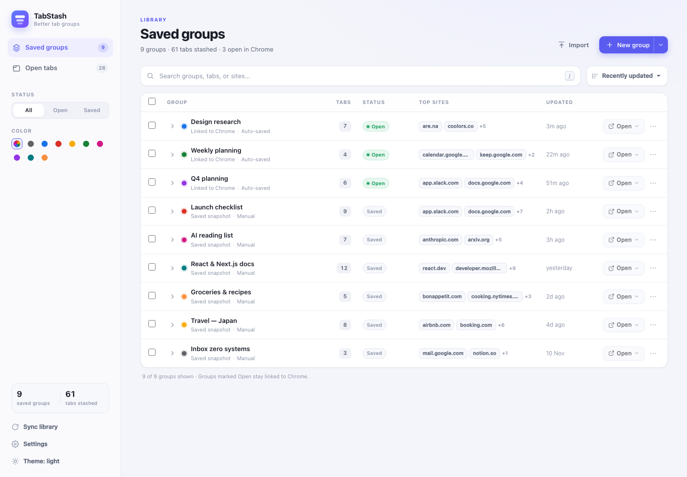
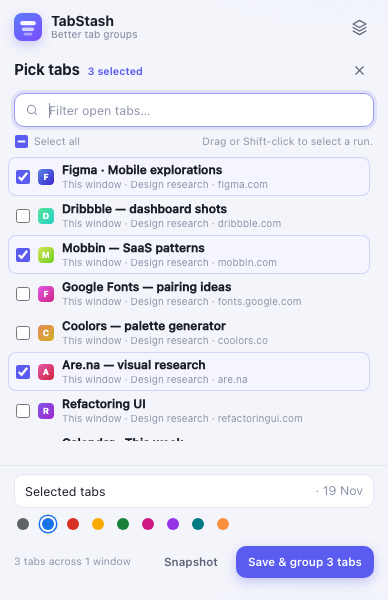
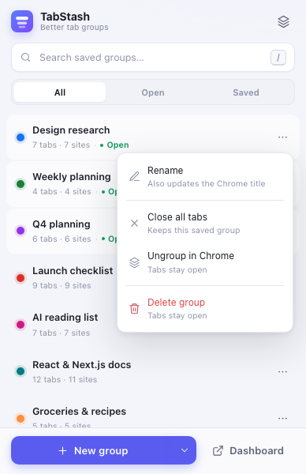

# TabStash

TabStash is a Chrome extension that turns your tab groups into a searchable library.

Chrome forgets a tab group the moment it is closed. TabStash keeps a copy of every group,
lets you search and multi-select across them, and reopens any group in the current window,
a new window, or an incognito window.



## Highlights

- **Auto-save every Chrome tab group.** Open groups stay linked and update as you edit
  them. Closing a group keeps the saved copy in your library.
- **A real dashboard, not a menu.** Saved groups and open tabs live in two sortable,
  filterable tables. Search by group name, tab title, or URL.
- **A tab picker built for selection.** Click **New group** in the dashboard or the popup
  to see every open tab with checkboxes. Check a few, select all, or drag down the column
  to select a run — then save it as a Chrome tab group or as a library-only snapshot.
- **Multi-select.** Select groups or tabs with checkboxes, Shift-click, drag, or
  `Ctrl/Cmd+A`, then open, save, group, pin, move, or close them in bulk.
- **Open anywhere.** Open a saved group in the current window, a new window, or incognito.
  Choose "Open all" from a group's expanded row to get every tab back at once.
- **Manage groups.** Rename, recolor, duplicate, export, or remove groups. Removing a live
  group also drops its Chrome group tag, leaving its tabs open in the window.
- **Import and export.** Back up your library as JSON, or import groups from another
  machine.
- **Light and dark themes.** Follow the system, or pin either theme.

## Install

TabStash is a Manifest V3 extension with no build step.

1. Open `chrome://extensions`.
2. Turn on **Developer mode** (top right).
3. Click **Load unpacked** and choose this folder (the one containing `manifest.json`).
4. Pin TabStash to the toolbar.

### Enable incognito windows

Opening groups in incognito requires Chrome's permission:

1. Open `chrome://extensions`.
2. On the TabStash card, click **Details**.
3. Turn on **Allow in Incognito**.

The dashboard and the popup both show whether that permission is enabled.

## Use it

### Dashboard

Open the dashboard from the popup footer, the extension's Options page, or
`Command+Shift+E` (`Ctrl+Shift+E` on other platforms).

- **New group** — opens the tab picker: a checkbox list of every open tab with search,
  **Select all**, and drag-to-select. Shift-click selects a run; with nothing clicked yet the
  run starts from the tab you are viewing. **Save & group** both saves the selection and
  creates a Chrome tab group, so it shows up in the tab bar. **Snapshot** saves without
  changing Chrome. New groups are named `Name · Date`; the date is added automatically and
  cannot be edited. The arrow next to it offers **Save this window** and **Import**.
- **Saved groups** — every group in your library. Expand a row to see its tabs. Filters
  cover open/saved status, color, and free-text search. Sort by recently updated,
  recently created, name, or size. The **Open** dropdown also has **Copy all links** and
  **Delete group** (or **Ungroup & remove** for an open group).
- **Open tabs** — every tab in every normal window. Filter by window and Chrome group,
  search titles and URLs, then select tabs to **Save & group** (or save a **Snapshot**),
  pin them, move them to another window, or close them. Drag down the checkbox column to
  select a run of tabs.

The selection bar appears as soon as something is selected and describes what will
happen before you run an action.

### Popup

Click the toolbar icon (or `Alt+Shift+S`).



- **New group** opens the tab picker: every open tab with checkboxes, search,
  **Select all**, and drag-to-select. Shift-click selects a run, starting from the tab you
  are viewing when nothing is selected yet. Name the group, pick a color, then
  **Save & group** to save it and create the Chrome tab group, or **Snapshot** to save it
  without touching Chrome. The `· Date` suffix is added automatically.
- The arrow next to **New group** offers **Save this window** — every tab in the current
  window as one group that is also grouped in Chrome.
- Search saved groups, filter by open or saved.
- Click a saved group to open it in the current window; click an open group to jump to it.
- Use the row buttons for new window and incognito.
- The **⋯** button on each row opens a menu: **Rename**, **Close all tabs** and
  **Ungroup in Chrome** (open groups only), then **Delete group**. Closing or ungrouping
  keeps the saved group; deleting removes it, and deletes never close its tabs.



### Auto-save behavior

- Any normal Chrome tab group is auto-saved and stays linked to its Chrome group.
- Renaming or recoloring the Chrome group updates the saved copy.
- Closing the Chrome group unlinks it but keeps the saved snapshot.
- Deleting a linked group from the dashboard ("Ungroup & remove") closes the bookkeeping
  and also removes the Chrome group tag. Its tabs stay open, now ungrouped.
- Incognito groups are ignored while **Track incognito windows** is off (the default).

### Shortcuts

| Shortcut | Where | Action |
| --- | --- | --- |
| `Alt+Shift+S` | Chrome | Open the popup |
| `Command/Ctrl+Shift+E` | Chrome | Open the dashboard |
| `/` | Dashboard, popup | Focus search |
| `Ctrl/Cmd+A` | Dashboard | Select everything in the current view |
| `Escape` | Dashboard, popup | Clear selection, close the picker, or close a dialog |
| `Space` / `Enter` | Tab picker | Toggle the focused tab |

## Settings

Open **Settings** in the dashboard header.

- **Theme** — system, light, or dark.
- **Auto-save Chrome groups** — mirror normal Chrome groups into the library.
- **Skip tabs already open** — avoid duplicate tabs when opening a saved group.
- **Ask before deleting** — confirm destructive actions.
- **Track incognito windows** — include incognito groups in the library.
- **Incognito access** — shows whether Chrome allows TabStash in incognito, with a shortcut
  to the extensions page.
- **Export all / Import JSON / Delete all data** — backups and cleanup.

Settings, saved groups, and the tracking ignore-list are stored in
`chrome.storage.local`. Nothing leaves your machine.

## Project layout

```
manifest.json          MV3 manifest
background.js          service worker: live group sync and messaging
shared/store.js        storage model, URL/favicon/format helpers
shared/actions.js      open/close/group/save operations shared by the UI
shared/icons.js        inline SVG icon set and brand mark
shared/drag-select.js  click-and-drag checkbox range selection
shared/theme.css       design tokens and base styles
dashboard/             full-page dashboard (HTML, CSS, JS)
popup/                 toolbar popup (HTML, CSS, JS)
icons/                 generated extension icons
tools/                 mock Chrome API + local preview server
.preview/              screenshots written by the preview workflow
```

## Development

```sh
npm run check     # syntax-check every script
npm run preview   # static server with a mocked chrome.* API
```

Then open:

- <http://localhost:4173/preview> — dashboard
- <http://localhost:4173/popup> — popup

Preview URLs accept `?theme=light|dark` and `?still=1` (disables animations for
screenshots). The mock in `tools/mock-chrome.js` seeds two windows, a handful of Chrome
groups, and nine saved groups, so both UIs can be exercised without Chrome APIs.

`tools/make-icons.mjs` regenerates `icons/icon*.png` if you change the brand mark.
